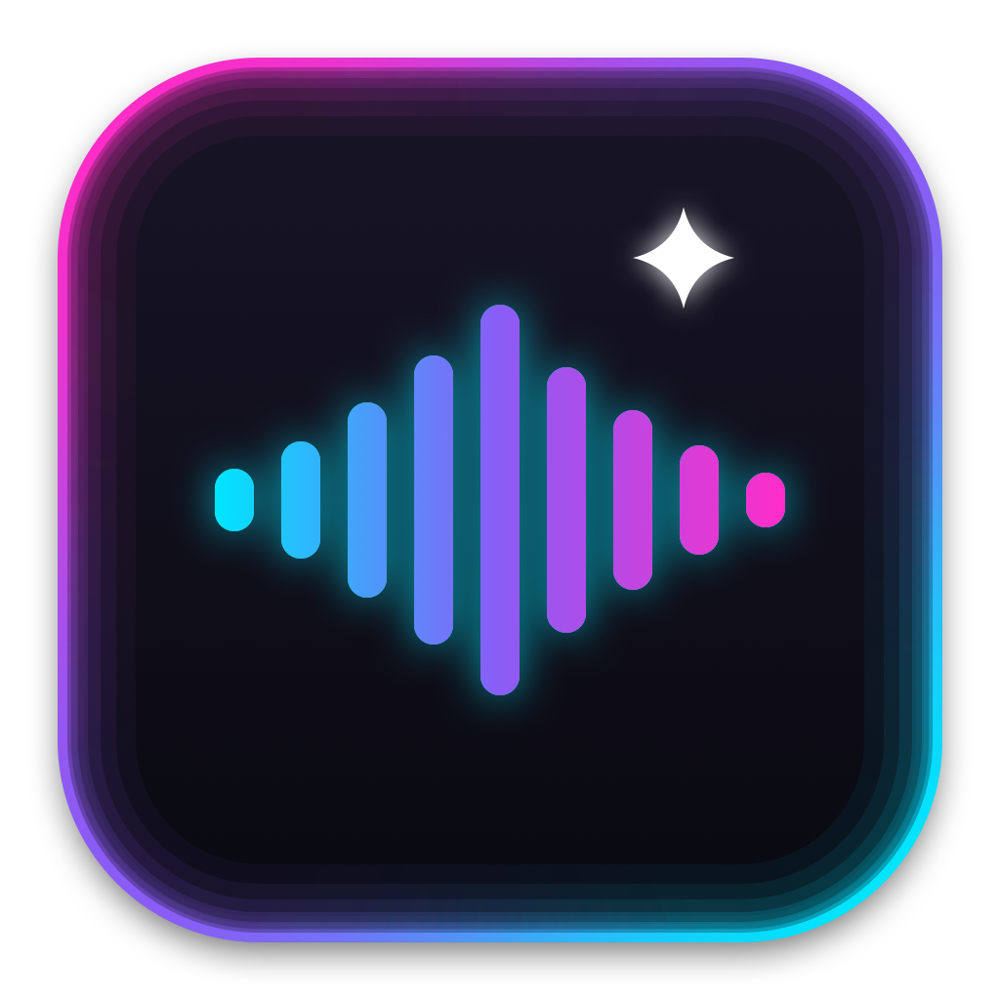

# EdgeGlow

Ambient screen-edge rim lighting for **macOS and Windows**, colored by album art and driven by live system audio.

<p align="center"></p>

## Repository layout

| Path | Contents |
|------|----------|
| `macos/` | The Swift app: `Sources/`, `Package.swift`, `Config/`, and `build.sh` (builds `EdgeGlow.app` / `EdgeGlow.dmg`) |
| `windows/` | The native Windows 10/11 app (C# / .NET 8, WPF + SkiaSharp + WASAPI) and `build.ps1` |
| `assets/` | Shared brand assets: the procedurally generated icon (`make_icons.sh` regenerates `AppIcon.icns` and `AppIcon.ico`) |
| `.github/workflows/` | `release-windows.yml` builds `EdgeGlow-Windows-x64.zip` and `EdgeGlow.dmg` and attaches them to a GitHub Release |

EdgeGlow draws a soft neon glow along the edges of your display (over the menu bar and around the
notch). Colors come from the album art of whatever is playing in Spotify, Apple Music or a YouTube
Music tab. The motion comes from your Mac's actual audio output, from any app: the bass makes the glow pulse and bloom, and the vocals set how fast it chases around the
screen. It lives in the menu bar and never takes clicks.

## Requirements (macOS)

- macOS 14 Sonoma or later, Apple Silicon
- Xcode 15+ or the Swift 5.9+ command-line tools
- Optional: Spotify, Apple Music, or YouTube Music in Safari or a Chromium browser for track info and
  album colors. Any other app's sound still drives the glow.

## macOS Installation Note

> **Downloading the `.dmg` from GitHub?** EdgeGlow is open source and only ad-hoc signed (it is not
> notarized by Apple), so macOS Gatekeeper will block it the first time you launch it.

First-time launch:

1. Open the downloaded `.dmg`.
2. Drag `EdgeGlow.app` to your `Applications` folder.
3. Open your `Applications` folder in Finder.
4. Right-click `EdgeGlow.app` and select **Open**.
5. Click **Open** again in the security prompt.

*(Alternatively, run `xattr -cr /Applications/EdgeGlow.app` in Terminal after installing.)*

You only need to do this once.

## Build & run

```sh
cd macos
./build.sh          # compile, sign, and launch EdgeGlow.app
./build.sh --dmg    # also package EdgeGlow.dmg
```

- **VS Code:** `Cmd+Shift+B` runs `macos/build.sh` (see `.vscode/tasks.json`).
- **Xcode:** open `macos/Package.swift`. Running from Xcode skips the app bundle, so AppleEvents permission
  prompts work most reliably from `./build.sh`.
- **SwiftPM:** `swift build` (inside `macos/`) compiles the same sources.

EdgeGlow needs two permissions, both under **System Settings → Privacy & Security**:

1. **Automation** for Spotify, Music, and your browser gives it the track info and album art. Each app
   is asked the first time it's needed. Browsers are only asked while audio is playing and neither
   Spotify nor Music is.
2. **Screen & System Audio Recording** gives it the system audio. Only audio is analyzed (the video
   stream is 2×2 px and thrown away), and the microphone is never used. macOS applies this grant
   only after a relaunch, so use the **Relaunch** button in the popover. Capture runs while the glow
   is on for at least one display, regardless of which app is playing, and pauses while the screens
   sleep. So the purple recording indicator stays on while EdgeGlow is active.

Ad-hoc-signed rebuilds change the app's signature, so macOS may forget both grants after a rebuild.
Sign with a stable identity to avoid that (`SIGN_IDENTITY="EdgeGlow Dev" ./build.sh`, using a
self-signed code-signing certificate). To reset the prompts, run:

```sh
tccutil reset AppleEvents com.jplane6.edgeglow
tccutil reset ScreenCapture com.jplane6.edgeglow
```

## Windows

Requirements: Windows 10 (version 2004 / build 19041) or Windows 11, x64. Nothing else to install: the
release is a self-contained single `EdgeGlow.exe`.

1. Download `EdgeGlow-Windows-x64.zip` from the latest GitHub Release and unzip it.
2. Run `EdgeGlow.exe`. It lives in the system tray (click the icon for the control flyout).
3. If SmartScreen warns that the app is unrecognized (it is open source and not code-signed), choose
   **More info → Run anyway**.

What maps to what on Windows:

| Feature | macOS | Windows |
|---------|-------|---------|
| Tray / menu bar UI | `NSStatusItem` popover | `NotifyIcon` + dark flyout |
| Click-through overlay | `NSPanel` | WPF window with `WS_EX_TRANSPARENT \| WS_EX_LAYERED \| WS_EX_TOPMOST \| WS_EX_TOOLWINDOW` |
| Per-display glow | display UUID | monitor hardware ID (EDID/device interface) |
| System audio | ScreenCaptureKit | WASAPI loopback (NAudio), no drivers needed |
| Now Playing | AppleScript | `GlobalSystemMediaTransportControlsSessionManager` (Spotify, Apple Music, Chrome, Edge, Arc, ...) |
| Rendering | SwiftUI Canvas | SkiaSharp |

The audio DSP (4 s rolling auto-gain, FFT bass/vocal bands, envelope followers), Cloud Sync (Deezer BPM +
LRCLIB lyrics), the album-art palette extractor, the four animation styles and the spring-mass edge physics
are ports of the macOS code with the same constants. The notch-aware bezel is macOS-only (no Windows
equivalent), so the Windows bezel is always a rounded rectangle.

Build it yourself (on Windows, with the .NET 8 SDK):

```powershell
cd windows
./build.ps1            # -> windows/dist/EdgeGlow.exe and EdgeGlow-Windows-x64.zip
```

Settings are stored in `%APPDATA%\EdgeGlow\settings.json`.

## Lyrics (macOS and Windows)

EdgeGlow shows synced lyrics next to the edge glow. The popover's mode picker chooses **Both**, **Glow Only**,
**Lyrics Only** or **Off** (Off stops rendering, audio capture and media polling).

- **11 styles**, all drawn by one Metal renderer with a real 3D perspective camera: Ship, Visual, Fisheye,
  Fisheye Visual, Constellation, Branches, Web, Codestyle Visual, Constellation 3D, HyperShip 3D, Orbital Web 3D.
  A semantic engine tags words (speed, impact, fire, heart, cosmic, vibe) and adds restrained accents and SF Symbol icons.
- **Fonts:** SF Pro, SF Rounded, New York, Helvetica Neue, Avenir Next, Futura, Didot.
- **Sources:** Spotify and Apple Music (exact position), plus browser tabs (YouTube, YouTube Music, SoundCloud,
  JioSaavn, Gaana, ...) through the HTML5 playhead when "Allow JavaScript from Apple Events" is on, or an
  audio-gated stopwatch otherwise.
- **Lyrics:** LRCLIB (exact, then ranked fuzzy search, then plain lyrics spread over the song) and NetEase.
  Messy Bollywood / YouTube metadata is cleaned first, and Hindi / Punjabi / Urdu lyrics can be romanized
  (toggle in the popover). About 170 Hinglish words map to icons.
- **Sync is automatic, there is no offset slider:** player poll latency is compensated, the output route's
  latency (CoreAudio, +165 ms detected for Bluetooth) is subtracted, and a vocal-onset lock (300 Hz-3.4 kHz) trims +/-200 ms.
- **Audio:** a CoreAudio process tap (macOS 14.2+; macOS asks once for "System Audio Recording"), with a
  ScreenCaptureKit audio-only fallback.

Debug helpers: `EdgeGlow --render-style-previews <dir>` renders every style to PNG,
`EdgeGlow --test-lyrics` runs the lyric lookup against a few Hindi / Punjabi tracks.

**Legibility on any wallpaper:** a dynamic dark scrim (rgba 8,8,12 at 78 % in the core, feathered) sits behind the
focal words; every word gets a crisp 1.5 px dark outline plus a wide 14 px ambient shadow under its accent glow; and
filaments / web rings / branch splines sit on a 3 px dark under-stroke. Verified over pure white and a light-mode browser page.

**Windows:** the same 11 styles, 7 fonts, 4-state mode selector, automatic sync pill and Hindi pipeline live in
`windows/EdgeGlow.Windows/Lyrics` (pure SkiaSharp: vector glyphs drawn through a perspective homography, so text stays razor sharp).
Differences from macOS: icons are Segoe UI Emoji instead of SF Symbols, the CoreGlyphs / NLEmbedding icon tiers have no Windows
counterpart (curated + Hinglish tables only), Urdu romanization is approximate (no vowel marks), fonts map to Segoe UI Variable,
Georgia, Arial, Century Gothic, Bahnschrift and Bodoni MT, and Bluetooth is detected from the endpoint enumerator (BTHENUM).
Browser tabs report their playhead through SMTC MediaSession. `windows/LyricPreview` is a console project that renders every
style to PNG on any OS (`dotnet run -c Release -- <dir> white|browser|gradient [style ...]`, `-- --test-lyrics`).

## Releases

Pushing a tag such as `v1.0.0` (or running the **Release** workflow manually with a `tag` input) builds both
platforms on GitHub Actions and attaches `EdgeGlow-Windows-x64.zip` and `EdgeGlow.dmg` to the release.

## How it works (macOS)

| File | Role |
| --- | --- |
| `main.swift` | Entry point that runs EdgeGlow as a menu bar (accessory) app |
| `AppDelegate.swift` | Status item (`sparkles.tv`), popover, and wiring |
| `AppState.swift` | Shared observable state and settings persisted in `UserDefaults` |
| `MediaModel.swift` | Platform-neutral `MediaSource`, `NowPlayingInfo`, `LevelSource` and the continuous `PlaybackClock` |
| `MediaBridge.swift` | AppleScript providers (Spotify, Apple Music, YouTube Music tabs), source priority, artwork lookup, and player notifications plus a 2 s backup poll |
| `CloudSync.swift` | Public metadata lookups (iTunes/Deezer artwork, Deezer BPM, LRCLIB synced lyrics), the LRC parser, and the beat/lyric synthesizer |
| `AudioCaptureManager.swift` | ScreenCaptureKit system-audio capture in any PCM format → vDSP FFT with rolling auto-gain → bass and vocal energies; output-route listener; live/Cloud Sync handoff |
| `ColorExtractor.swift` | Artwork download/cache; picks vivid primary and secondary colors with 32×32 RGBA hue bucketing |
| `OverlayPanel.swift` | Full-screen, click-through `NSPanel` above the menu bar |
| `OverlayWindowManager.swift` | One overlay panel (and renderer) per enabled display; adds and removes panels as displays are toggled, plugged in or unplugged |
| `GlowOverlayView.swift` | 60 fps `TimelineView` + `Canvas` with a blurred ambient spill, a crisp bezel rim that wraps the notch automatically, comets and sparks |
| `MenuBarPopoverView.swift` | Dark control panel: now playing, colors, styles, displays, sliders, toggles |

- **Sources:** Spotify, then Apple Music, then any system audio (named after a YouTube Music tab when
  one is open). A paused native player still shows when nothing else is playing. Apple Music and
  YouTube Music don't expose artwork URLs, so the cover is looked up on the iTunes Search API, with
  Deezer as a fallback. Plain system audio uses the default palette.
- **Audio engine:** system audio arrives in whatever format the device uses: any sample rate, Float32
  or Int16/Int32 PCM, interleaved or not. It is mixed to mono and run through a Hann-windowed FFT
  (2048 points, or 4096 above 64 kHz) about 50 times a second. Energy in the 20–150 Hz band (bass)
  and the 300–3000 Hz band (vocals) is divided by its own 4-second rolling maximum (auto-gain, with a
  -60 dBFS floor and a -78 dBFS gate), so local peaks reach 1.0 at any volume. A fast-attack,
  smooth-decay envelope then turns each band into a steady 0–1 value.
- **Speakers:** switching the default output (Bluetooth, AirPlay, USB) restarts capture on the new
  route after a 350 ms debounce.
- **Cloud Sync** (badge shows **SYNC**): Spotify Connect, or AirPlay sent straight from the player,
  leaves the Mac silent. When Spotify or Music reports playback but the Mac has stayed below -72 dBFS
  for 1.5 s, the glow is driven from the track instead:
  - *Bass* is a kick on every beat at the Deezer BPM (122 if unknown), with an accented downbeat.
  - *Vocals* follow the active LRCLIB synced-lyric line's syllable rate: about 0.4 for slow lines,
    0.85–1.0 for fast ones, decaying to 0.08 between lines. Without synced lyrics they swell over
    4-bar phrases.
  - The track position comes from the player poll, extrapolated continuously in between.
  - As soon as local audio rises above -68 dBFS, the live FFT takes over again.
  - Beat phase assumes the first beat falls at 0:00, so it can be offset on tracks with a pickup or
    intro. Track and artist names are sent to iTunes, Deezer and LRCLIB, and nothing else is.
- **Complex wave:** bass drives stroke thickness, opacity and blur bloom in every animated style.
  Vocal energy drives how fast the Chasing and Symmetry comets move: they glide when nobody is singing and speed
  up on dense vocals. With no audio and no Cloud Sync, the glow falls back to a gentle breathing animation.
- **Kinetic physics** (popover toggle, on by default; always on in Sparks Only):
  - *Bounce:* the bezel is a 240-node spring–mass string. Each bass transient plucks it inward at the
    brightest point on the rim, and the ripples travel along the edges and ring down in about a second.
  - *Sparks:* bass and vocal transients fire 3–8 sparks inward from the hot spots. They slow down
    and fade over about a second, with faint constellation lines between nearby sparks.
  - *Impact:* when the bass envelope goes above 0.8, the crisp rim splits into a red copy pushed
    outward and a cyan copy pulled inward, and the glow shakes slightly.
  - When nothing is happening, the edge is drawn as the original rounded rectangle.
- **Animation styles:**
  - *Breathing:* a rotating two-color rim with a kick pulse.
  - *Chasing:* two comets, each a white-hot head fading into a tail, race clockwise around an
    otherwise dark bezel. Vocals speed them up and the bass thickens and blooms them. The
    "Comet Length" slider sets the tail length as a share of the perimeter.
  - *Symmetry:* a mirrored pair of comets leaves top-center, runs down the left and right edges
    together and merges in a bloom at bottom-center (with a spark burst when kinetic physics is on).
    At the moment they merge, the direction flips: the next pair launches from bottom-center and climbs
    both edges to merge at top-center, and it keeps alternating from there. Each new pair rises out
    of the previous pair's draining tails. Their speed follows the vocals.
  - *Sparks Only:* no rim at all. The only thing drawn is the sparks thrown inward from the dark edges
    on hard bass transients.
- **Notch:** each display's renderer checks its own screen. On a built-in panel with a camera notch
  (top safe-area inset over 30 pt) the glow path wraps around the notch; external displays get the
  plain rounded rectangle.
- **Multiple displays:** every connected display is listed in the popover with a checkmark. Turn on
  any combination, from none (glow hidden) to all of them at once. Each enabled display gets its own
  overlay. An enabled display that is unplugged keeps its setting, and its glow comes back when it
  is reconnected.
- **Idle glow:** with "Keep Idle Glow When Paused" on, a dimmer, slowly breathing glow stays lit
  while nothing is playing. Turn it off to fade the overlay out when music stops.
- **No microphone, and no screen pixels are analyzed.** Screen & System Audio Recording permission
  is needed only because ScreenCaptureKit is macOS's API for system audio.
